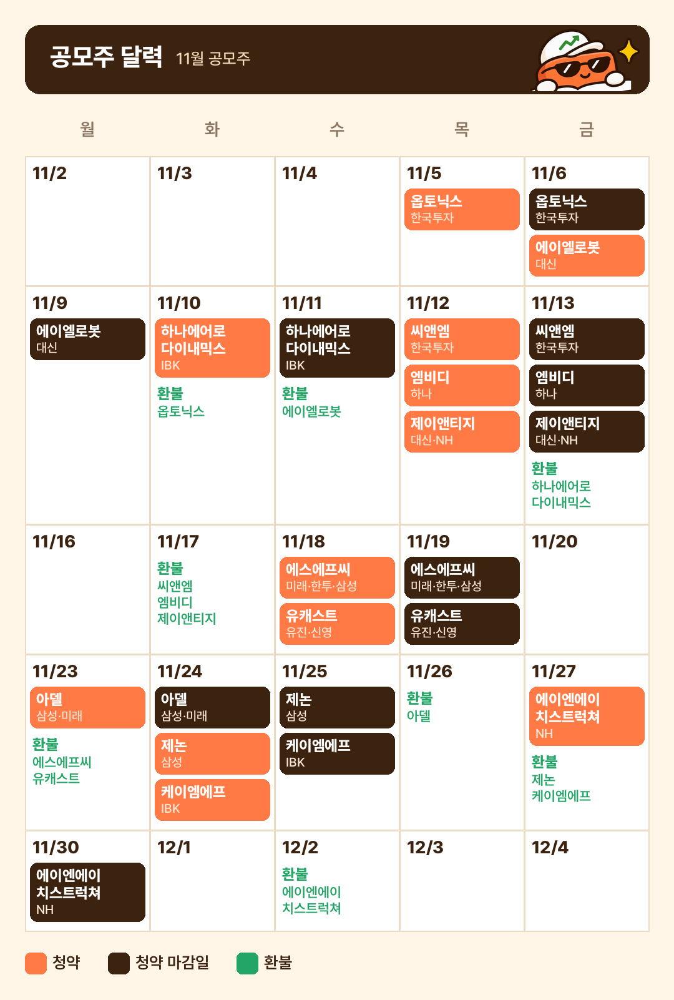

안녕하세요, 브릭로그입니다.

11월 공모주 일정표는 이미 많이 나와 있어서, 저는 조금 다르게 정리해봤습니다. 스팩을 뺀 16곳 가운데 11월 6일 기준으로 12곳이 남았는데, 언제 청약하는지와 함께 <b>환불금이 언제 돌아오는지, 지금 시장에서 어디에 넣어야 할지</b>를 같이 봤습니다.

브릭로그는 공모주를 볼 때 자금, 시황, BRICK CHECK 순서로 봅니다. 이 글도 그 순서대로 갑니다.

### 📅 11월 공모주 달력: 청약일과 환불일

오렌지가 청약 첫날, 갈색이 마감일, 초록이 돈이 돌아오는 날입니다. 남은 12곳을 모두 넣으려면 계좌는 7개가 필요한데, 한국투자, 대신, IBK, 삼성, 하나, NH에 유진이나 신영 중 하나를 더하면 됩니다.

같은 종목을 두 증권사에서 넣을 수는 없고, 증권사마다 비대면 계좌 개설 제한이 있으니 청약 직전에 만들려면 미리 확인해두는 게 좋습니다.

---

### 💸 청약일보다 환불일을 먼저 보는 이유

증거금은 환불되면 다음 청약에 다시 쓸 수 있어서, 돈이 돌아오는 날에 맞춰 순서를 짜면 같은 돈으로 여러 곳을 넣을 수 있습니다. 문제는 앞에 넣은 돈이 돌아오기 전에 다음 마감이 먼저 오는 날이에요.

| 날짜 | 이날 마감 | 아직 안 돌아온 돈 | 돌아오는 날 |
| --- | --- | --- | --- |
| 11/9 | 에이엘로봇 | 옵토닉스 | 11/10 |
| 11/13 | 씨앤엠 · 엠비디 · 제이앤티지 | 세 곳이 같은 날 마감 | 11/17 |
| 11/19 | 에스에프씨 · 유캐스트 | 두 곳이 같은 날 마감 | 11/23 |
| 11/25 | 제논 · 케이엠에프 | 아델, 그리고 두 곳이 같은 날 마감 | 아델 11/26, 두 곳 11/27 |

이 네 날은 넣고 싶은 종목을 같이 넣을 만큼 돈이 있는지 먼저 봐야 합니다. 반대로 11월 17일 환불금은 18\~19일 청약에, 23일 환불금은 아델에, 27일 환불금은 에이엔에이치스트럭쳐에 이어서 쓸 수 있습니다.

<b>같은 돈을 여러 번 돌릴 수 있는 달이지만, 돌아오는 날을 놓치면 넣고 싶은 종목에 돈이 없을 수 있습니다.</b>

환불금이 들어오는 시간과 다른 증권사로 옮기는 시간은 증권사마다 다르니, 마감일 당일에 옮길 계획이라면 먼저 확인해두세요. 최소 청약 수량이 확인된 곳은 옵토닉스 20주(12만 원), 에이엘로봇 10주(8만 8,000원)이고, 나머지는 종목별 글에서 공모가와 함께 다루겠습니다.

---

### 🌧️ 시황: 11월 공모주를 넣어도 되는 분위기일까?

자금 다음은 시황입니다. 11월 5일 코스피는 5.28%, 코스닥은 5.11% 빠졌는데, 하루만 나빴던 게 아니라 흐름 자체가 무겁습니다.

| 지수 | 11/5 하루 | 5거래일 | 20거래일 |
| --- | --- | --- | --- |
| 코스피 | -5.28% | -9.33% | -20.87% |
| 코스닥 | -5.11% | -9.93% | -24.49% |

이미 상장한 공모주에도 바로 나타났습니다. 최근 상장한 4곳을 11월 5일 종가로 보면 3곳이 공모가 아래에 있습니다.

| 종목 | 상장일 | 공모가 | 11/5 종가 | 공모가 대비 |
| --- | --- | --- | --- | --- |
| 인텔리빅스 | 10/30 | 9,000원 | 12,900원 | +43.3% |
| 영광 | 11/2 | 17,000원 | 11,300원 | -33.5% |
| 래블업 | 11/3 | 19,000원 | 10,290원 | -45.8% |
| 이에스티 | 11/4 | 12,400원 | 7,550원 | -39.1% |

여기 나온 영광은 선박 부품 회사로, 이번에 청약한 영광와이케이엠씨와는 다른 회사입니다.

<b>공모주가 상장 시점의 시장 분위기를 얼마나 크게 타는지, 이번 주에 숫자로 본 셈입니다.</b>

남은 12곳 중 급락 전에 공모가가 정해진 곳은 옵토닉스와 에이엘로봇뿐이고, 나머지 10곳은 수요예측이 11월 5일 뒤에 끝납니다. 기관들이 어떤 가격을 적어내는지가 이번 달의 가장 큰 관전 포인트라고 봅니다.

| 종목 | 공모가 (희망 범위) | 수요예측 종료 | 업종 |
| --- | --- | --- | --- |
| 옵토닉스 | 12,000원 확정 | 끝남 | 광학 부품 |
| 에이엘로봇 | 17,600원 확정 | 끝남 | 로봇 센서·제어 |
| 하나에어로다이내믹스 | 4,700\~5,700원 | 11/6 | 항공기 부품 |
| 엠비디 | 9,600\~11,700원 | 11/6 | 검사·분석 기구 |
| 씨앤엠 | 10,000\~13,000원 | 11/9 | 전동기·발전기 |
| 제이앤티지 | 26,400\~31,900원 | 11/9 | 비금속 광물제품 |
| 에스에프씨 | 31,600\~36,100원 | 11/13 | 화학제품 (코스피) |
| 유캐스트 | 19,000\~23,000원 | 11/13 | 무선 통신장비 |
| 아델 | 18,000\~25,000원 | 11/18 | 신약 연구개발 |
| 제논 | 9,700\~12,200원 | 11/20 | 생성형 AI 플랫폼 |
| 케이엠에프 | 15,000\~17,800원 | 11/20 | 식품 |
| 에이엔에이치스트럭쳐 | 11,200\~13,600원 | 11/25 | 엔지니어링 |

일정이 바뀐 곳도 있습니다. 제논은 11월 초에서 24일로 미뤄졌고, 다비오는 12월 1일로 넘어가면서 11월 목록에서 빠졌어요.

---

### 🗓️ 넣기 전에 먼저 볼 수 있는 성적표

시황이 흔들릴 때는 먼저 상장하는 종목의 결과가 좋은 참고가 됩니다. 11월은 일정이 꽤 잘 맞아서, 11월 10일부터 사흘 동안 나오는 결과를 보고 12일에 시작하는 세 곳을 판단할 수 있습니다.

| 상장일 | 종목 | 확인할 점 |
| --- | --- | --- |
| 11/10 | 동원파츠 | 확약이 가장 높았던 종목의 첫 반응 |
| 11/11 | 바로팜 | 희망 범위 맨 아래로 정해진 공모주의 첫 반응 |
| 11/12 | 넥스아이 | 희망 범위보다 낮게 정해진 공모주의 첫 반응 |
| 11/16 | 영광와이케이엠씨 | 11/18\~19 청약 전 참고 |
| 11/17 | 옵토닉스 | 11/18\~19 청약 전 참고 |

에이엘로봇과 하나에어로다이내믹스를 포함한 나머지 종목은 아직 상장일이 공시되지 않았습니다.

<b>넣을지 말지는 달력에 적힌 앞선 상장 결과를 보고 정해도 늦지 않습니다.</b>

---

### 📊 BRICK CHECK로 본 먼저 나온 6곳

수요예측 결과가 나온 6곳은 BRICK CHECK 5개 기준 중 수요와 확약 두 가지만 먼저 매겨봤습니다.

| 종목 | 공모가 | 기관 경쟁률 | 수요 등급 | 확약 | 확약 등급 |
| --- | --- | --- | --- | --- | --- |
| 옵토닉스 | 12,000원 (상단) | 1,201.81 : 1 | A | 5.62% | C |
| 영광와이케이엠씨 | 11,000원 (상단) | 1,163.35 : 1 | A | 7.21% | C |
| 에이엘로봇 | 17,600원 (상단) | 871.74 : 1 | B | 1.13% | C |
| 동원파츠 | 26,500원 (상단) | 840.86 : 1 | B | 16.61% | B |
| 바로팜 | 16,400원 (하단) | 152.36 : 1 | C | 0.03% | C |
| 넥스아이 | 8,000원 (범위 아래) | 66.58 : 1 | C | 0.06% | C |

경쟁률은 종목마다 크게 갈리는데 확약은 거의 다 낮습니다. 6곳 중 확약이 B라도 나온 곳은 동원파츠 하나뿐이고, 경쟁률이 1,000대 1을 넘은 두 곳도 확약은 C였어요.

11월 10일 동원파츠 상장이 그래서 더 궁금합니다. 확약이 가장 높은 종목이 이 시장에서 어떻게 움직이는지 보여줄 테니까요.

---

### 🧱 그래서 저는요

11월은 달력에 있는 공모주를 다 넣기보다, 일정과 지금 가진 자금, 환불일을 같이 놓고 들어갈 종목을 고르려고 합니다.

자금이 넉넉하지 않다면 마감이 겹치는 날에는 한두 곳만 고르고, 환불금이 돌아오는 날에 맞춰 다음 청약으로 넘기는 식으로요. 무엇을 고를지는 앞서 상장한 종목의 결과와 BRICK CHECK를 보고 정할 생각입니다.

<b>이번 달 공모주는 얼마나 많이 넣느냐보다, 내 자금으로 어떤 순서로 넣느냐가 더 중요해 보입니다.</b>

종목별 글은 결과가 나오는 대로 올리겠습니다.

- 영광와이케이엠씨: [https://blog.naver.com/brick-log/224465360537](https://blog.naver.com/brick-log/224465360537)
- 옵토닉스: [https://blog.naver.com/brick-log/224465384718](https://blog.naver.com/brick-log/224465384718)
- 에이엘로봇: [https://blog.naver.com/brick-log/224466336669](https://blog.naver.com/brick-log/224466336669)

---

<i>이 글은 투자 권유가 아닌 개인 기록입니다. 투자 판단과 책임은 본인에게 있습니다.</i>

<i>출처: 38커뮤니케이션, Yahoo Finance, 시사저널e, 장전닷케이알, glasswallet (2026.11.2\~11.5)</i>

#11월공모주 #공모주일정 #공모주청약일정 #공모주 #공모주청약 #11월공모주일정 #증거금 #증거금환불일 #공모주캘린더 #브릭로그
